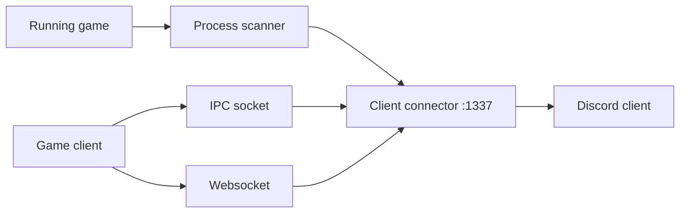

<div align="center">

# rsRPC

**Shows what game you're playing on Discord, for Linux setups where the official client can't. For gamers and tinkerers.**

[](https://github.com/Delnegend/rsRPC/actions)
[](https://github.com/Delnegend/rsRPC/releases)
[](LICENSE)

</div>

---

## Quick Start

Get running in less than 60 seconds:

```bash
# 1. Install
brew install Delnegend/tap/rsrpc

# 2. Run it — fetches Discord's game list automatically
rsrpc
```

Playing Windows games through Steam Play or Proton? Install the bridge too, then point the game's Steam launch options at it:

```bash
brew install Delnegend/tap/rsrpc-bridge
# Steam launch options: $(brew --prefix)/opt/rsrpc-bridge/libexec/bridge.sh %command%
```

Not on Homebrew? Grab the latest Linux binary from [Releases](https://github.com/Delnegend/rsRPC/releases):

```bash
URL=$(curl -fsSL https://api.github.com/repos/Delnegend/rsRPC/releases/latest | grep -o 'https://[^"]*x86_64-unknown-linux-gnu\.tar\.xz')
curl -fsSL -o rsrpc.tar.xz "$URL" && tar -xJf rsrpc.tar.xz --strip-components=1
./rsrpc
```

Open Discord and launch a game: your status updates. Press `Ctrl+C` to stop.

## Highlights

- **One command to install** — `brew install Delnegend/tap/rsrpc`; the tap follows releases, so `brew upgrade` keeps you current.
- **Zero setup for most games** — downloads Discord's detectable-games list on start, no config file needed.
- **Catches games three ways** — running-process scan, local socket, and browser websocket, so odd launchers still show up.
- **Windows games too** — the `rsrpc-bridge` formula covers Proton and Wine games that never touch the host IPC socket.
- **Your list, your rules** — point it at your own `detectable.json`, or add and scan games while it runs.

## Common Options

```bash
# Use your own game list instead of Discord's
rsrpc --detectable-file ./detectable.json
```

| Option | Default | Description |
|---|---|---|
| `-d, --detectable-file <file>` | Discord's list | Path to a custom `detectable.json` game list |
| `-n, --no-process-scan` | `false` | Skip the running-process scan (socket + websocket only) |

For the library API, `RPCConfig` fields, and `RSRPC_LOGS_ENABLED`, see **[Configuration Reference](openwiki/operations/configuration.md)**.

## Architecture



For connectors, event flow, and design notes, see **[Architecture Overview](openwiki/architecture/overview.md)**.

## Documentation (OpenWiki)

- **[Quickstart](openwiki/quickstart.md)** — Get running in under 60 seconds with Homebrew, Docker, or systemd.
- **[Architecture Overview](openwiki/architecture/overview.md)** — Connectors, event flow, and invariants.
- **[Activity Middleware](openwiki/architecture/middleware.md)** — Sanitization pipeline for thread names and mod watermarks.
- **[Proton & Wine Bridge](openwiki/integrations/proton-bridge.md)** — Connect Windows games running in Steam Proton, Lutris, or Wine.
- **[Configuration](openwiki/operations/configuration.md)** — CLI flags, `RPCConfig`, env vars, and the Rust API.
- **[Deployment & Operations](openwiki/operations/deployment.md)** — Install from Homebrew or releases, and run under systemd.

## License

[MIT](LICENSE) — fork of [SpikeHD/rsRPC](https://github.com/SpikeHD/rsRPC), inspired by [arRPC](https://github.com/OpenAsar/arRPC).
