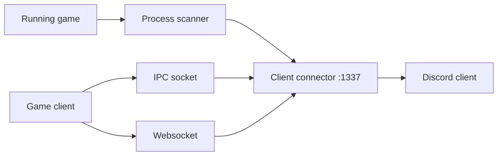

<div align="center">

# rsRPC

**Shows what game you're playing on Discord, for Linux setups where the official client can't. For gamers and tinkerers.**

[](https://github.com/Delnegend/rsRPC/actions)
[](https://github.com/Delnegend/rsRPC/releases)
[](LICENSE)

</div>

---

## Quick Start

Get running in less than 60 seconds:

```bash
# 1. Install — grab the binary for your OS from Releases
curl -fSLO https://github.com/Delnegend/rsRPC/releases/latest/download/rsrpc-x86_64-unknown-linux-gnu.zip && unzip rsrpc-*.zip

# 2. Run it — fetches Discord's game list automatically
./rsrpc-cli
```

Open Discord and launch a game: your status updates. Press `Ctrl+C` to stop.

## Highlights

- **Zero setup for most games** — downloads Discord's detectable-games list on start, no config file needed.
- **Catches games three ways** — running-process scan, local socket, and browser websocket, so odd launchers still show up.
- **Your list, your rules** — point it at your own `detectable.json`, or add and scan games while it runs.
- **Use it as a part, not just an app** — the `rsrpc` crate embeds the same server in your own Rust program.

## Common Options

```bash
# Use your own game list instead of Discord's
./rsrpc-cli --detectable-file ./detectable.json
```

| Option | Default | Description |
|---|---|---|
| `-d, --detectable-file <file>` | Discord's list | Path to a custom `detectable.json` game list |
| `-n, --no-process-scan` | `false` | Skip the running-process scan (socket + websocket only) |

For the library API, `RPCConfig` fields, and `RSRPC_LOGS_ENABLED`, see **[Configuration Reference](docs/configuration.md)**.

## Architecture



For connectors, event flow, and design notes, see **[Architecture Guide](docs/architecture.md)**.

## Documentation

- **[Configuration](docs/configuration.md)** — CLI flags, `RPCConfig`, env vars, and the Rust API.
- **[Architecture](docs/architecture.md)** — Connectors, event flow, and invariants.
- **[Deployment](docs/deployment.md)** — Install from releases and run under systemd.
- **[Development](docs/development.md)** — Dev container, build, `just check`, releases.
- **[Proton & Wine Bridge](docs/proton-bridge.md)** — Connect Windows games running in Steam Proton, Lutris, or Wine.

## License

[MIT](LICENSE) — fork of [SpikeHD/rsRPC](https://github.com/SpikeHD/rsRPC), inspired by [arRPC](https://github.com/OpenAsar/arRPC).
