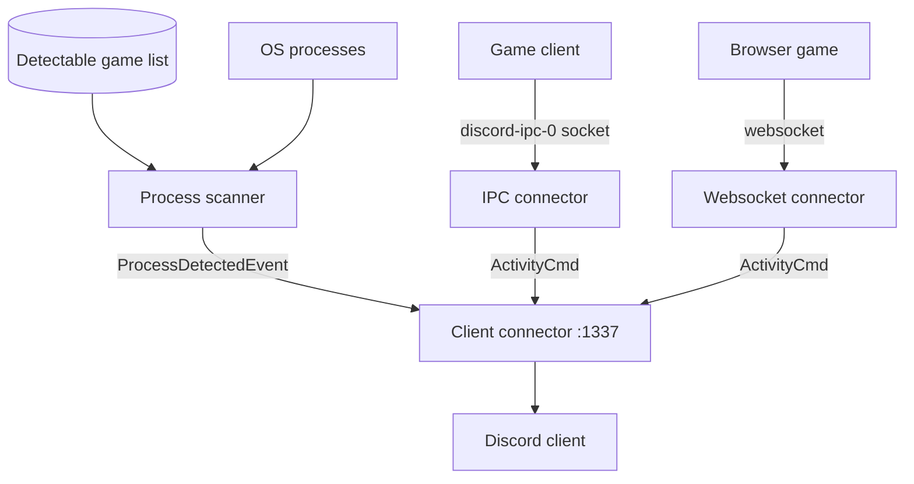

# Architecture

## Overview

`rsrpc` is a local stand-in for Discord's game-detection service. It watches
for running games three ways, merges the events, and serves them to Discord
clients over a local socket and websocket — the same endpoints the official
client listens on.

## Core components (`crates/lib/src/`)

- **Process scanner** (`server/process.rs`): polls the OS process list and
  matches executable paths against the detectable list with an Aho-Corasick
  automaton over reversed paths (suffix match). Runs on its own thread.
- **IPC connector** (`server/ipc_unix.rs`, `server/ipc_win.rs`): owns the
  `discord-ipc-0` socket (`$XDG_RUNTIME_DIR` on Linux, named pipe on Windows),
  handles the `client_id` handshake, retries `discord-ipc-1…` if taken, and
  cleans up stale sockets.
- **Websocket connector** (`server/websocket.rs`): accepts browser/websocket
  game clients.
- **Client connector** (`server/client_connector.rs`): the hub. Receives events
  from all three sources over `mpsc` channels and broadcasts payloads to
  connected Discord clients on `port` (default `1337`).
- **Detection list** (`detection.rs`): parses Discord's `detectable.json`
  schema (`DetectableActivity`); `RPCServer` also exposes runtime
  add/remove/scan methods.

## Invariants & guarantees

- **Connectors start once:** `RPCServer::start()` builds the connector set a
  single time; runtime mutation goes through `append_detectables` /
  `remove_detectable_by_name` / `scan_for_processes`.
- **Callback before start:** `on_process_scan_complete` must be registered
  before `start()`; setting it later logs a warning and is ignored.
- **Fail-open detection:** a stale `discord-ipc-N` socket is removed and
  retried rather than crashing the server.
- **Pure-Rust TLS:** HTTP fetches use `ureq` + `rustls`, so releases need no
  system OpenSSL.
