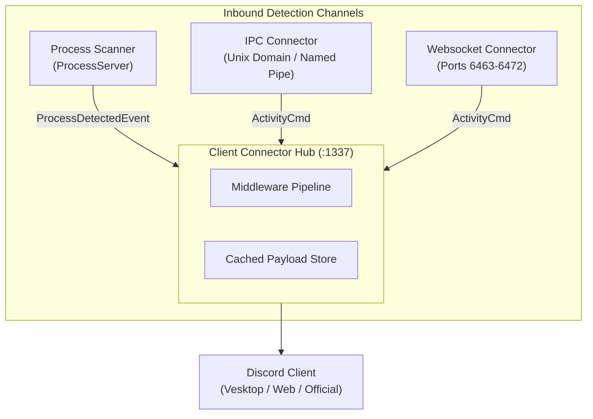

# Architecture

## Overview

rsRPC is a local daemon standing in for Discord's native game-detection service on Linux. It observes active games across multiple channels and serves payloads to Discord clients over local sockets and WebSockets.

## Core Components

- **Process Scanner:** Polls the OS process list and matches executable paths against Discord's `detectable.json` catalog using an Aho-Corasick automaton.
- **IPC Connector:** Owns the local `discord-ipc-0` socket (`$XDG_RUNTIME_DIR/discord-ipc-0`), validates handshakes, and handles framing up to 1 MiB.
- **WebSocket Connector:** Listens across candidate ports `6463`-`6472` for browser-based games and secondary Discord events with strict origin checks.
- **Client Connector Hub:** Central event broker listening on port `1337` where Discord clients connect, caching and replaying payloads.

## Invariants & Guarantees

- **Single-Flight Initialization:** Server starts all connector threads once; redundant start calls return `RpcError::AlreadyStarted`.
- **Fail-Open Stale Socket Recovery:** Unlinks dead leftover IPC sockets on connection failure and rebinds cleanly.
- **Degraded Connectors Kept Alive:** Unavailable IPC or WebSocket ports log warnings and degrade to disabled facades without killing the process.
- **Strict Hub Port Binding:** Port 1337 is required; failure to bind immediately halts startup with `AddrInUse` rather than running partially.
- **Immediate State Replay:** New or reconnecting Discord clients immediately receive cached activity payloads following the `READY` handshake.
