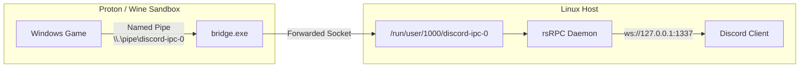

# 1. Proton & Wine Bridge Guide

Guide for Linux users running Windows games via Steam Proton, Lutris, or Wine with `rsrpc`.



---

## 2. Why a bridge is needed

Windows games communicate with Discord using a Windows named pipe (`\\.\pipe\discord-ipc-0`). On Linux, native Discord clients and `rsrpc` listen on a Unix domain socket located at `/run/user/<UID>/discord-ipc-0` (or `$XDG_RUNTIME_DIR/discord-ipc-0`).

Because Steam Proton isolates games inside container sandboxes (Pressure Vessel), Windows named pipes cannot reach host Linux sockets directly. A lightweight bridge utility (`rpc-bridge`) runs inside the game prefix and forwards the packets across the sandbox boundary to `rsrpc`.

---

## 3. Steam Proton setup

### Step 1: Install the bridge files

Download the latest release of `rpc-bridge` and install `bridge.sh` and `bridge.exe` to a local folder:

```bash
mkdir -p ~/.local/share/rpc-bridge
curl -fSL -o ~/.local/share/rpc-bridge/winediscordipcbridge.exe https://github.com/0e4ef622/wine-discord-ipc-bridge/releases/download/v0.0.3/winediscordipcbridge.exe
curl -fSL -o ~/.local/share/rpc-bridge/bridge.sh https://raw.githubusercontent.com/0e4ef622/wine-discord-ipc-bridge/master/winediscordipcbridge-steam.sh
chmod +x ~/.local/share/rpc-bridge/bridge.sh
```

### Step 2: Configure Steam launch options

1. Open Steam, right-click your game, and select **Properties**.
2. In the **General** tab under **Launch Options**, set:

```bash
~/.local/share/rpc-bridge/bridge.sh %command%
```

3. Launch your game through Steam.

---

## 4. Lutris & generic Wine setup

For standalone Wine or Lutris prefixes:

1. Copy `bridge.exe` to `drive_c/windows/bridge.exe` inside your game's Wine prefix.
2. In Lutris, open the game configuration:
   - Set **Executable** to the path of `bridge.exe`.
   - In **Arguments**, provide the path to your Windows game executable, for example:
     `"C:\Games\MyGame\game.exe"`

Alternatively, run `wine bridge.exe` once inside the prefix and click **Install** to register it as a persistent background service.

---

## 5. Flatpak permissions

If Steam, Discord, or Vesktop runs inside a Flatpak, grant permission to access the Discord IPC socket:

```bash
# Allow Flatpak applications access to the Discord IPC socket
flatpak override --user --filesystem=xdg-run/discord-ipc-0
```

---

## 6. Verification & troubleshooting

| Check | Expected result | Action if failed |
|---|---|---|
| **Host socket** | `ls -l "$XDG_RUNTIME_DIR"/discord-ipc-0` exists | Ensure `rsrpc` is running on the host |
| **Bridge log** | `<prefix>/drive_c/windows/logs/bridge.log` created | Check launch options path to `bridge.sh` |
| **Discord status** | Discord profile displays in-game activity | Verify the game supports native Discord RPC |

### Games without native Discord RPC

Some games (like *Risk of Rain 2* after update 1.5.0) removed their native Discord RPC caller and only broadcast to Steam. For these games, install a community mod (such as `DiscordRichPresence` via BepInEx) to generate the in-game RPC packets, which the bridge will then forward to `rsrpc`.
