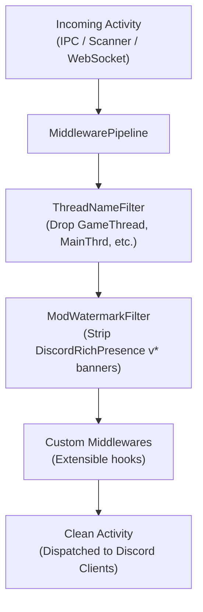

# Activity Middleware Pipeline

The activity middleware pipeline provides an extensible hook system to inspect, clean, and enrich Discord activity payloads before they are serialized and broadcast to connected Discord clients.


*Activity middleware execution order applied in the client connector hub before JSON dispatch.*

## Core Components

The pipeline lives in `crates/lib/src/middleware.rs` and exposes two core abstractions:

- **`ActivityMiddleware` trait:** A thread-safe trait defining `fn process(&self, activity: &mut Activity)`. Middlewares mutate or prune activity fields in place.
- **`MiddlewarePipeline`:** An ordered container holding registered middlewares in an `Arc<dyn ActivityMiddleware>` vector. Calling `pipeline.process(&mut activity)` invokes each middleware sequentially.

## Built-in Middlewares

`MiddlewarePipeline::default_rules()` registers two default cleanup filters:

### 1. `ThreadNameFilter`

Cleans internal game engine execution thread names from `activity.details` and `activity.state`. Certain game engines (such as Unreal Engine 5 via `pthread_setname_np("GameThread")`) set thread names that leak into Linux process scanners and window titles.

Generic thread names filtered to `None`:
- `GameThread`
- `RenderThread`
- `RHIThread`
- `AudioThread`
- `MainThrd`
- `MainThread`
- `wine-preloader`
- `wine64-preloader`
- `wineserver`

### 2. `ModWatermarkFilter`

Strips promotional version banners and self-advertising text from `assets.large_text` and `assets.small_text`. For example, community Rich Presence mods (such as *Risk of Rain 2* community mods) populate `large_text` with `"DiscordRichPresence v1.3.5"`. The filter resets promotional strings to `None` while preserving legitimate map names and character descriptors.

## Integration in `ClientConnector`

`ClientConnector` acts as the single convergence hub for all activity sources. `MiddlewarePipeline` is held in `ClientConnector.middleware` and invoked across all three inbound channels:

1. **IPC Stream:** After unpacking `ActivityCmd` from local Unix/named-pipe sockets.
2. **Process Scanner:** After matching detected OS processes and evaluating window titles.
3. **WebSocket:** After validating web client `SET_ACTIVITY` commands.

```rust
// Applied in crates/lib/src/server/client_connector.rs
if let Some(activity) = activity {
    activity.application_id = ipc_activity.application_id;
    ipc_clone.middleware.process(activity);
    let payload = ActivityPayload { ... };
}
```

## Adding Custom Middlewares

Applications embedding the `rsrpc` library can extend the pipeline at runtime:

```rust
use rsrpc::cmd::Activity;
use rsrpc::middleware::{ActivityMiddleware, MiddlewarePipeline};

struct CustomPrefixMiddleware;

impl ActivityMiddleware for CustomPrefixMiddleware {
    fn process(&self, activity: &mut Activity) {
        if let Some(details) = activity.details.as_mut() {
            *details = format!("[MODIFIED] {details}");
        }
    }
}

let mut pipeline = MiddlewarePipeline::default_rules();
pipeline.add(CustomPrefixMiddleware);
```
