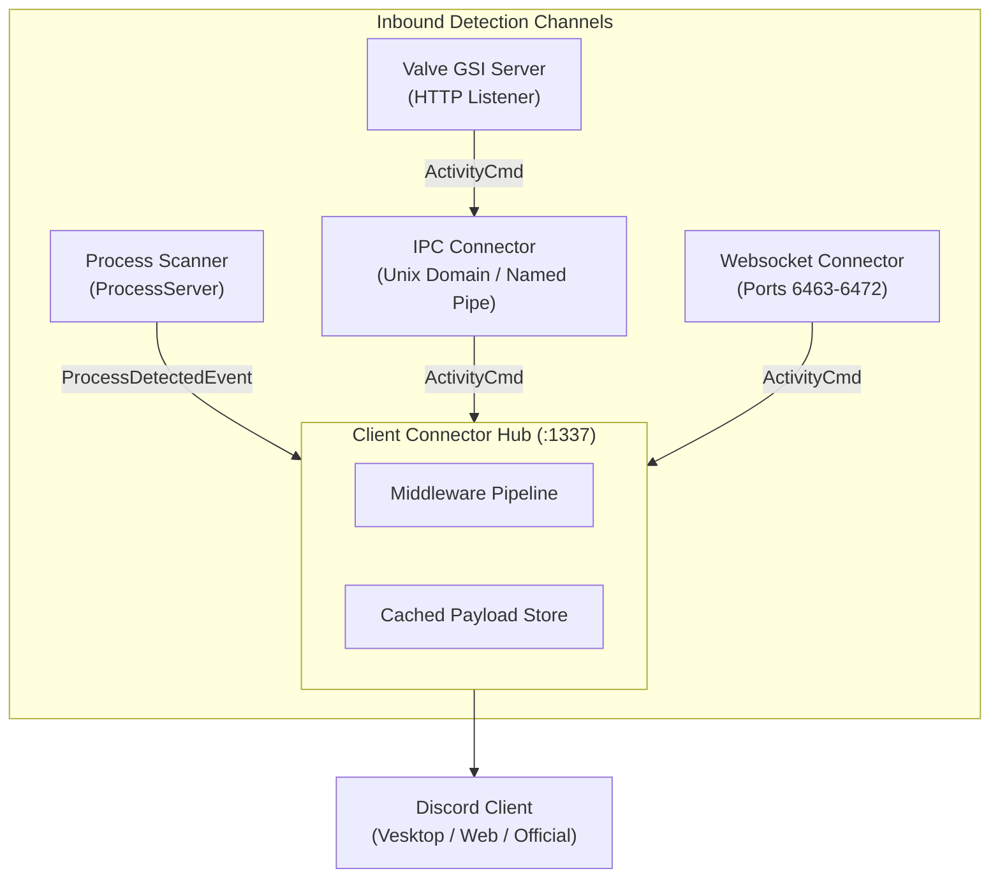

# Architecture Overview

`rsrpc` is a high-performance local daemon standing in for Discord's native game-detection service. It observes active games across multiple channels, applies sanitization and enrichment, and serves payloads to Discord clients over local sockets and WebSockets.

*Inbound detection channels converging on the ClientConnector hub before dispatch to Discord.*

## Core Components

The core library (`crates/lib/src/`) provides four primary sub-servers:

### 1. Process Scanner (`server/process.rs`)
Polls the operating system process list and matches executable paths against Discord's `detectable.json` catalog using an Aho-Corasick automaton over reversed paths for fast suffix matching. Runs on a dedicated background thread with thread-safe custom detectable updates.

### 2. IPC Connector (`server/ipc_unix.rs`, `server/ipc_win.rs`, `server/ipc_utils.rs`)
Owns the local `discord-ipc-0` socket (`$XDG_RUNTIME_DIR/discord-ipc-0` on Linux, Win32 named pipe on Windows). Performs client handshake validation, handles framing up to a bounded `MAX_FRAME` cap (1 MiB), automatically cleans up stale sockets, and recovers gracefully from unannounced peer disconnection.

### 3. WebSocket Connector (`server/websocket.rs`)
Hunts for an available port between `6463` and `6472` to accept browser-based games and secondary Discord events (`INVITE_BROWSER`, `SET_ACTIVITY`). Origin headers are strictly checked against `VALID_ORIGINS` before payload deserialization.

### 4. Client Connector Hub (`server/client_connector.rs`)
The central event broker. Listens on port `1337` (or configured port) where Discord clients (such as Vesktop, web clients, or open-source clients) connect. Channels from the Process Scanner, IPC Connector, and WebSocket Connector deliver events to the hub over `std::sync::mpsc` channels.

## System Invariants & Guarantees

- **Single-Flight Initialization:** `RPCServer::start()` initializes all connector threads once. Re-calling `start()` or modifying callbacks after initialization returns `RpcError::AlreadyStarted`.
- **Fail-Open Stale Socket Recovery:** If an existing IPC socket is found on the filesystem, `rsrpc` attempts connecting to it. If the connection fails (indicating a dead process leftover), `rsrpc` unlinks the dead socket and re-binds cleanly.
- **Immediate State Replay on Connect:** `ClientConnector` caches the latest active activity payload (`last_payload`). When a Discord client connects or reconnects after game startup, `rsrpc` immediately replays the cached activity frame following the `READY` handshake.
- **Unbounded Stalls Contained:** Every IPC stream runs in its own thread; stalled clients block only their connection thread without starving the central listener or other connectors.
