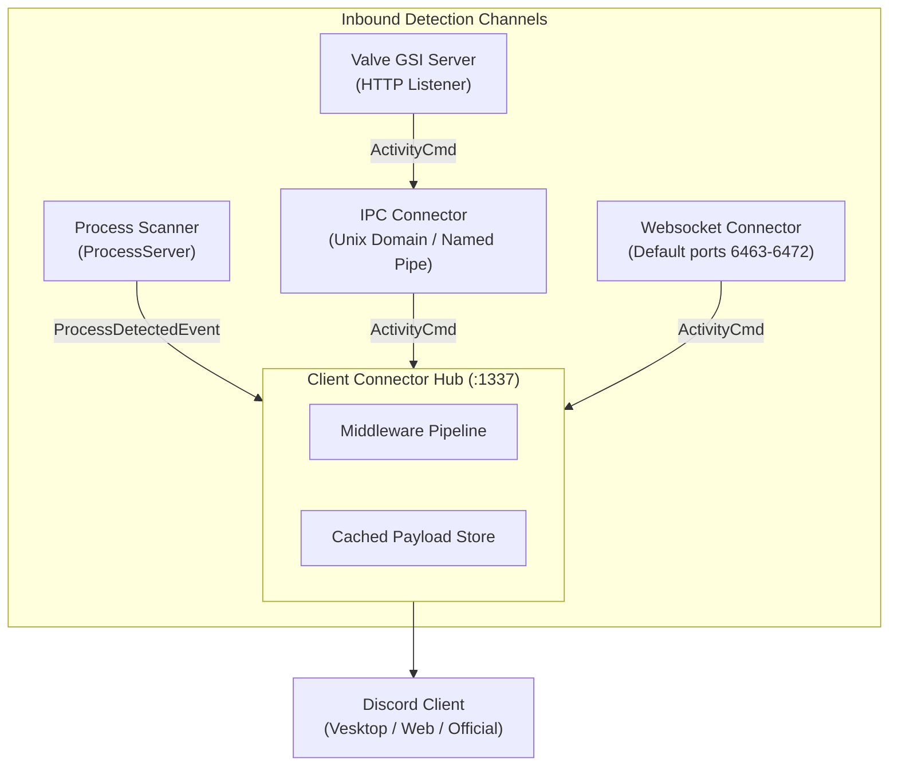

# Architecture Overview

`rsrpc` is a high-performance local daemon standing in for Discord's native game-detection service. It observes active games across multiple channels, applies sanitization and enrichment, and serves payloads to Discord clients over local sockets and WebSockets.

*Inbound detection channels converging on the ClientConnector hub before dispatch to Discord.*

## Core Components

The core library (`crates/lib/src/`) provides four primary sub-servers:

### 1. Process Scanner (`server/process.rs`)
Polls the operating system process list and matches executable paths against Discord's `detectable.json` catalog using an Aho-Corasick automaton over reversed paths for fast suffix matching. The automaton, its `[activity, executable]` index table, and the activity list live behind a single mutex as one coherent `DetectState` snapshot taken per scan, so a concurrent custom-detectable rebuild cannot tear an in-flight match; matching is bounds-checked, so stale state yields no match instead of a panic. When nothing is detected, the scanner forwards the synthetic `NULL_ACTIVITY_ID` (`"null"`) activity, which tells connectors to clear the current presence; the scan loop stops when its event receiver is gone. Runs on a dedicated background thread with thread-safe custom detectable updates.

### 2. IPC Connector (`server/ipc_unix.rs`, `server/ipc_win.rs`, `server/ipc_utils.rs`)
Owns the local `discord-ipc-0` socket (`$XDG_RUNTIME_DIR/discord-ipc-0` on Linux, Win32 named pipe on Windows). Performs client handshake validation, handles framing up to a bounded `MAX_FRAME` cap (1 MiB), automatically cleans up stale sockets, and recovers gracefully from unannounced peer disconnection. When no socket can be bound at all (every candidate slot is taken), the connector is created disabled: `start` logs and returns without a listener or thread instead of exiting the host process, keeping the rest of the daemon alive.

### 3. WebSocket Connector (`server/websocket.rs`)
Hunts sequentially for an available port across its candidate range — `6463` through `6472` inclusive by default, overridable via the `RSRPC_WS_PORTS` environment variable (a single port or an inclusive range) — to accept browser-based games and secondary Discord events (`INVITE_BROWSER`, `SET_ACTIVITY`). Origin headers are strictly checked against `VALID_ORIGINS` before payload deserialization. If every candidate port is taken, `RPCServer::start` logs a warning and continues with a disabled facade (no listener) rather than failing to start.

### 4. Client Connector Hub (`server/client_connector.rs`)
The central event broker. Listens on port `1337` (or configured port) where Discord clients (such as Vesktop, web clients, or open-source clients) connect. Channels from the Process Scanner, IPC Connector, and WebSocket Connector deliver events to the hub over `std::sync::mpsc` channels.

## System Invariants & Guarantees

- **Single-Flight Initialization:** `RPCServer::start()` initializes all connector threads once. Re-calling `start()` or modifying callbacks after initialization returns `RpcError::AlreadyStarted`.
- **Fail-Open Stale Socket Recovery:** If an existing IPC socket is found on the filesystem, `rsrpc` attempts connecting to it. If the connection fails (indicating a dead process leftover), `rsrpc` unlinks the dead socket and re-binds cleanly.
- **Degraded Connectors Don't Kill the Daemon:** If no IPC socket can be bound, the IPC connector comes up disabled (logged error) instead of exiting the process, and if no websocket port can be bound, `RPCServer::start` continues with a disabled facade (logged warning). The process scanner and client connector hub keep serving.
- **Immediate State Replay on Connect:** `ClientConnector` caches the latest active activity payload (`last_payload`). When a Discord client connects or reconnects after game startup, `rsrpc` immediately replays the cached activity frame following the `READY` handshake.
- **Unbounded Stalls Contained:** Every IPC stream runs in its own thread; stalled clients block only their connection thread without starving the central listener or other connectors.
