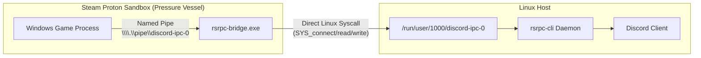

# Wine & Proton IPC Bridge

`rsrpc-bridge` is a dedicated Windows proxy executable written in Rust that enables Windows games running under Wine, Proton, or Steam Play to communicate with the host Linux `rsrpc` daemon for Rich Presence.


*rsrpc-bridge proxying named pipe calls to host Unix domain sockets across the Proton sandbox boundary.*

## The Compatibility Challenge

Windows games using the Discord GameSDK connect to a Windows named pipe (`\\.\pipe\discord-ipc-0`). On Linux, Discord clients and `rsrpc` listen on a Unix domain socket (`$XDG_RUNTIME_DIR/discord-ipc-0`).

Under Steam Proton, games execute inside an isolated container sandbox (Pressure Vessel) managed by `bwrap`. Two major hurdles prevent Rich Presence from working out of the box:
1. **Container Isolation:** The sandbox does not mount `/run/user/<uid>/discord-ipc-0` by default.
2. **Missing Winsock `AF_UNIX` in Upstream Wine:** Standard Proton Wine does not enable `AF_UNIX` address family support in `ws2_32.dll`. Proxies relying on standard Winsock APIs crash on startup.

## How `rsrpc-bridge` Works

`rsrpc-bridge` solves both barriers:

- **Inside the Prefix:** Runs as `rsrpc-bridge.exe` inside the Wine prefix. It calls Win32 `CreateNamedPipeW` and `ConnectNamedPipe` to create the server end of `\\.\pipe\discord-ipc-0` within the wineserver namespace.
- **Direct Kernel Syscalls:** Rather than relying on Wine's Winsock layer, `rsrpc-bridge` invokes raw Linux system calls (`SYS_socket`, `SYS_connect`, `SYS_read`, `SYS_write`, `SYS_close`) directly via inline assembly (`core::arch::asm!`). This bypasses Wine entirely and connects straight to the host Linux kernel socket.
- **Bidirectional Relay:** Buffers and forwards frames bidirectionally between the game's named pipe handle and the Linux socket file descriptor until either endpoint closes.

## Steam Proton Configuration

### 1. Build or Install the Bridge Artifacts

Cross-compile the Windows binary using the container build recipe or copy release artifacts:

```bash
just bridge
# Copies target/x86_64-pc-windows-gnu/release/rsrpc-bridge.exe and bridge.sh to dist/
mkdir -p ~/.local/share/rpc-bridge
cp dist/rsrpc-bridge.exe dist/bridge.sh ~/.local/share/rpc-bridge/
chmod +x ~/.local/share/rpc-bridge/bridge.sh
```

### 2. Set Steam Launch Options

In Steam, right-click the game $\rightarrow$ **Properties** $\rightarrow$ **Launch Options**:

```bash
~/.local/share/rpc-bridge/bridge.sh %command%
```

`bridge.sh` scans `$XDG_RUNTIME_DIR`, `/run/user/$UID`, and Flatpak paths for active `discord-ipc-*` sockets, exposes them read-write into `PRESSURE_VESSEL_FILESYSTEMS_RW`, and sets `PROTON_REMOTE_DEBUG_CMD` to launch `rsrpc-bridge.exe` inside the game's Wine environment.
