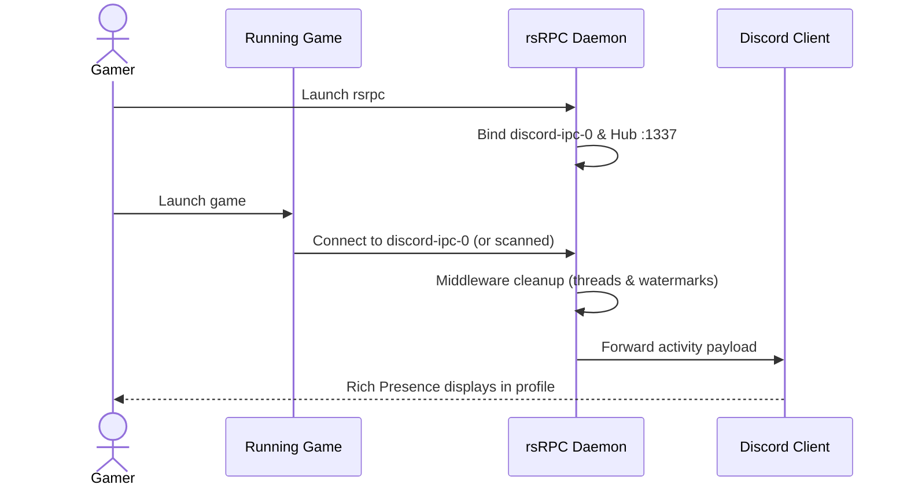

# Quickstart

Get running with `rsrpc` on Linux in less than 60 seconds.


*End-to-end presence flow from game launch through rsRPC to the Discord client.*

## 1. Install and Run (Homebrew)

The tap is the primary install path. It ships the prebuilt binary, follows
releases automatically, and upgrades with the rest of your system:

```bash
# Install
brew install Delnegend/tap/rsrpc

# Start the daemon — it fetches Discord's game list on first run
rsrpc
```

Open your Discord client (Vesktop, Discord Web, or Discord Desktop) and launch a game. Your Rich Presence updates automatically.

Press `Ctrl+C` to stop the daemon cleanly.

Keep it current the usual way:

```bash
brew upgrade rsrpc
```

### Without Homebrew

Every release publishes pre-built binaries:

```bash
# Download and unpack
curl -fSLO https://github.com/Delnegend/rsRPC/releases/latest/download/rsrpc-x86_64-unknown-linux-gnu.zip
unzip rsrpc-*.zip

# Start the daemon
./rsrpc-x86_64-unknown-linux-gnu
```

### From Source

To build and run directly from this repository:

```bash
# Build the optimized release binary
cargo build -p rsrpc --release

# Run
./target/release/rsrpc
```

## 2. Windows Games on Steam (Proton)

If you play Windows games through Steam Play / Proton, install the bridge. It
is a Windows proxy that runs inside the game's Wine prefix and relays its named
pipe to the host socket:

```bash
# 1. Install the bridge
brew install Delnegend/tap/rsrpc-bridge

# 2. Add to game launch options in Steam
$(brew --prefix)/opt/rsrpc-bridge/libexec/bridge.sh %command%
```

Prefer not to use the tap? Unzip `rsrpc-bridge-x86_64-pc-windows-gnu.zip` from
a release, or build it with `just bridge`, then keep the `.exe` next to
`bridge.sh` in a directory of your choice and point the launch option at it.

See the [Wine & Proton Bridge](integrations/proton-bridge.md) page for how the
sandbox boundaries are handled.

## 4. Documentation Map

| Area | Documentation Page | Purpose |
|---|---|---|
| **System Architecture** | [`/openwiki/architecture/overview.md`](architecture/overview.md) | Component design, event loops, connector hub, and invariants |
| **Activity Sanitization** | [`/openwiki/architecture/middleware.md`](architecture/middleware.md) | Middleware pipeline, thread-name filter, and mod watermark cleaner |
| **Wine / Proton Bridge** | [`/openwiki/integrations/proton-bridge.md`](integrations/proton-bridge.md) | Bridging Windows game named pipes to Linux sockets under Proton |
| **Configuration Options** | [`/openwiki/operations/configuration.md`](operations/configuration.md) | CLI flags, environment variables, and `RPCConfig` reference |
| **Production Deployment** | [`/openwiki/operations/deployment.md`](operations/deployment.md) | Systemd user service, logging, and operational health checks |
